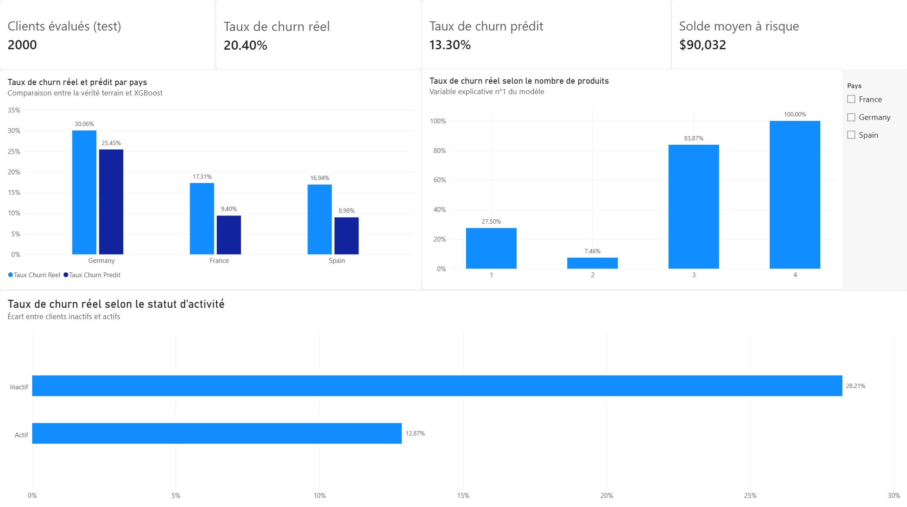
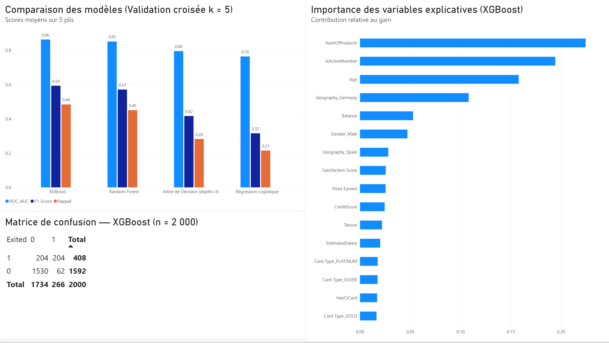
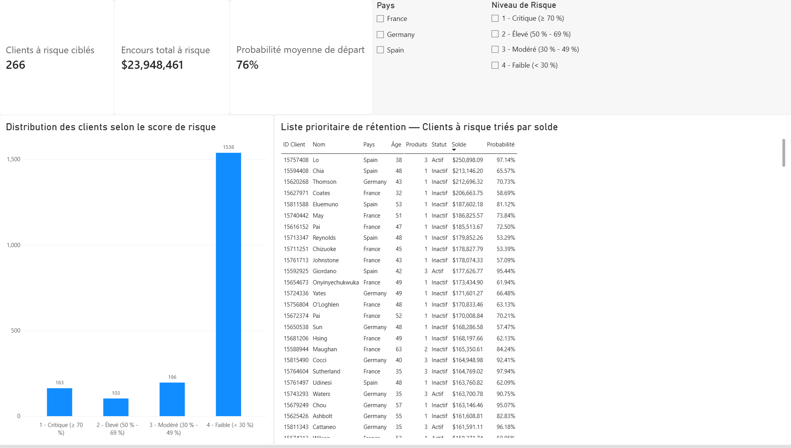

# Prédiction de l'attrition bancaire (Customer Churn) — Python & Power BI


Projet d'intégration réalisé dans le cadre du **Certificat en science des données (SCI 1402)** à l'**Université TÉLUQ**. L'objectif est d'identifier les facteurs statistiquement associés au départ des clients d'une banque ($N = 10\,000$), de bâtir un modèle prédictif robuste et de déployer un outil décisionnel interactif dans Power BI permettant de prioriser les actions de rétention.

---

## 1. Contexte et objectifs d'affaires

L'acquisition d'un nouveau client bancaire coûte nettement plus cher que la rétention d'un client existant. Face à un taux d'attrition global de **20,37 %**, ce projet répond à trois besoins opérationnels :

1. **Comprendre les profils à risque** grâce à des tests d'hypothèses inférentiels rigoureux (sans confondre corrélation et causalité).
2. **Prédire la probabilité de départ** de chaque client à l'aide d'algorithmes d'apprentissage supervisé évalués sur des données hors échantillon.
3. **Outiller les équipes d'affaires** via un rapport Power BI en trois volets reliant l'analyse exploratoire, la performance des modèles et une liste d'intervention prioritaire chiffrée en dollars.

---

## 2. Structure du dépôt

```text
bank-customer-churn/
│
├── notebooks/
│   └── Analyse_Churn_Bancaire_SCI1402.ipynb   # Pipeline complet (EDA, tests statistiques, ML, exports CSV)
│
├── data/
│   ├── Customer-Churn-Records.csv             # Jeu de données brut (10 000 clients)
│   ├── bank_churn_predictions_powerbi.csv     # Prédictions hors échantillon (jeu de test, n = 2 000)
│   ├── comparaison_modeles_powerbi.csv        # Métriques numériques de validation croisée (k = 5)
│   └── importance_xgboost.csv                 # Contribution relative des 16 variables explicatives
│
├── powerbi/
│   └── Dashboard_Churn_Bancaire.pbix          # Tableau de bord interactif (3 pages)
│
├── images/
│   ├── page1_analyse_clients.png              # Capture de la Page 1 (Analyse Clients)
│   ├── page2_performance_ml.png               # Capture de la Page 2 (Performance Modèles ML)
│   └── page3_clients_a_risque.png             # Capture de la Page 3 (Clients à Risque)
│
└── README.md

```

---

## 3. Méthodologie et rigueur analytique

* **Prévention de la fuite de données (*Data Leakage*) :** La variable `Complain` (présentant une corrélation quasi parfaite de ~0,99 avec `Exited`, car enregistrée au moment de la plainte de fermeture) a été exclue avant la modélisation, au même titre que les identifiants non informatifs (`RowNumber`, `CustomerId`, `Surname`).
* **Séparation stratifiée (80 / 20) :** Le jeu de données a été divisé avec `train_test_split(..., stratify=y, random_state=42)` afin de préserver exactement la proportion de départs (~20,4 %) dans l'ensemble d'entraînement ($n = 8\,000$) et l'ensemble de test ($n = 2\,000$).
* **Tests statistiques adaptés à l'hétéroscédasticité :**
  * **Tests du Khi-deux ($\chi^2$) et tableaux croisés en pourcentages** pour les variables catégorielles.
  * **Tests *t* de Welch** (`equal_var=False`) pour comparer les moyennes entre clients fidèles et partants malgré le déséquilibre des classes et l'inégalité des variances.
  * **ANOVA de Welch et test post-hoc de Games-Howell** (`pingouin`) pour analyser les disparités financières entre marchés géographiques.
* **Validation croisée stratifiée ($k = 5$) :** Comparaison de 4 familles de modèles (*Régression Logistique*, *Arbre de Décision*, *Random Forest* et *XGBoost*) selon le **ROC-AUC**, le **F1-Score** et le **Rappel**.

---

## 4. Principaux résultats

### A. Constats de l'analyse exploratoire et inférentielle

* **Disparité géographique majeure :** Le test du Khi-deux rejette l'indépendance ($p < 0{,}001$). L'Allemagne affiche un taux de départ de **32,44 %**, soit le double de la France (**16,15 %**) et de l'Espagne (**16,67 %**). L'ANOVA de Welch et le test de Games-Howell démontrent également que le solde moyen en Allemagne (**~119 730 $**) est presque deux fois supérieur à celui de la France (**~62 093 $**) et de l'Espagne (**~61 818 $**), rendant l'attrition allemande particulièrement coûteuse.
* **Engagement et équipement produit :** Les membres inactifs quittent nettement plus la banque (**26,85 %**) que les membres actifs (**14,27 %**). Par ailleurs, détenir **2 produits** réduit fortement le taux d'attrition (**7,58 %** contre **27,71 %** pour 1 produit), tandis que le risque grimpe fortement à **3 ou 4 produits** (> 82 %).
* **Profil démographique et financier :** Les clients qui quittent sont significativement plus âgés (moyenne de **44,8 ans** contre **37,4 ans**, $p < 0{,}001$) et détiennent un solde bancaire plus élevé (**91 108 $** contre **72 745 $**, $p < 0{,}001$). À l'inverse, le type de carte, la possession d'une carte de crédit, le salaire estimé et l'ancienneté n'ont pas d'effet statistiquement significatif ($p > 0{,}05$).

### B. Performance des modèles (Validation croisée stratifiée $k = 5$)

| Modèle | ROC-AUC (CV) | F1-Score (CV) | Rappel (CV) |
| :--- | :---: | :---: | :---: |
| **XGBoost** | **0,8633 ± 0,0081** | **0,5935 ± 0,0076** | **0,4843 ± 0,0116** |
| **Random Forest** | 0,8517 ± 0,0092 | 0,5712 ± 0,0174 | 0,4509 ± 0,0181 |
| **Arbre de Décision (`max_depth=3`)** | 0,7955 ± 0,0094 | 0,4168 ± 0,0405 | 0,2826 ± 0,0380 |
| **Régression Logistique** | 0,7644 ± 0,0060 | 0,3157 ± 0,0203 | 0,2149 ± 0,0171 |

### C. Évaluation finale de XGBoost et segmentation du risque ($n = 2\,000$)

* **Variables les plus déterminantes :** `NumOfProducts` (22,5 %), `IsActiveMember` (19,4 %), `Age` (15,8 %) et `Geography_Germany` (10,8 %) concentrent près de **68,5 %** de l'importance totale du modèle.
* **Matrice de confusion (au seuil standard de 0,50) :**
  * **Vrais Négatifs (VN) :** 1 530 | **Faux Positifs (FP) :** 62
  * **Faux Négatifs (FN) :** 204 | **Vrais Positifs (VP) :** 204
  * **Précision :** **76,7 %** (lorsque le modèle prédit un départ, il a raison plus de 3 fois sur 4) | **Rappel :** **50,0 %** (la moitié des départs réels sont interceptés).
* **Impact financier et segmentation des probabilités :** Sur les 2 000 clients évalués, les **266 clients prédits à risque** ($\text{probabilité} \ge 50\,\%$) représentent un encours total menacé de **23 948 461 $** (solde moyen de **92 116 $** et probabilité moyenne de départ de **75,54 %**). La segmentation complète répartit le portefeuille en **163 clients** en risque *Critique* ($\ge 70\,\%$), **103** en risque *Élevé* ($50\,\% - 69\,\%$), **196** en risque *Modéré* ($30\,\% - 49\,\%$) et **1 538** en risque *Faible* ($< 30\,\%$).

---

## 5. Tableau de bord décisionnel Power BI (3 pages)

Le fichier `Dashboard_Churn_Bancaire.pbix` exploite les prédictions hors échantillon du jeu de test ($n = 2\,000$) et des mesures DAX personnalisées :

1. **Page 1 — Analyse Clients :** Indicateurs clés du jeu de test, comparaison géographique entre taux réel et prédit, impact du nombre de produits, écart selon le statut d'activité et filtre dynamique par pays.
2. **Page 2 — Performance Modèles ML :** Comparaison visuelle des scores CV des 4 modèles, classement des 16 variables explicatives de XGBoost et matrice de confusion interactive.
3. **Page 3 — Clients à Risque (Outil opérationnel de rétention) :** Quantification de l'encours total à risque (**23 948 461 $**), distribution des clients par tranche de probabilité et tableau d'intervention prioritaire trié par solde décroissant, filtrable par pays et niveau de risque.





---

## 6. Recommandations d'affaires

1. **Plan de rétention prioritaire sur les encours élevés et le marché allemand :** Déployer des appels proactifs auprès des 163 clients en tranche *Critique* ($\ge 70\,\%$) triés par solde bancaire (Page 3), en ciblant particulièrement les clients allemands inactifs âgés de 40 à 60 ans où les soldes moyens avoisinent 120 000 $.
2. **Stratégie de vente croisée (*Cross-Selling* maîtrisé) :** Encourager l'adoption d'un **2e produit bancaire** chez les clients mono-produit (le taux de churn chutant de 27,7 % à 7,6 %), tout en auditant l'expérience des détenteurs de 3 ou 4 produits pour corriger les frictions tarifaires ou opérationnelles.
3. **Campagnes de réactivation préventive :** Déclencher des relances automatisées dès qu'un client bascule vers un statut inactif (`IsActiveMember = 0`).
4. **Optimisation du seuil de décision :** Abaisser le seuil d'intervention autour de `0,30` lors des campagnes numériques à faible coût unitaire afin d'inclure les **196 clients de la tranche Modérée (30 % - 49 %)** et d'intercepter davantage de faux négatifs en France et en Espagne.

---

## 7. Technologies utilisées et auteur

* **Langage et bibliothèques :** Python (`pandas`, `numpy`, `scipy`, `pingouin`, `scikit-learn`, `xgboost`, `matplotlib`, `seaborn`)
* **Business Intelligence :** Microsoft Power BI Desktop (Power Query, modélisation, colonnes calculées et mesures DAX)
* **Auteur :** Jean-François Lafrenière — Étudiant au Certificat en science des données, Université TÉLUQ
